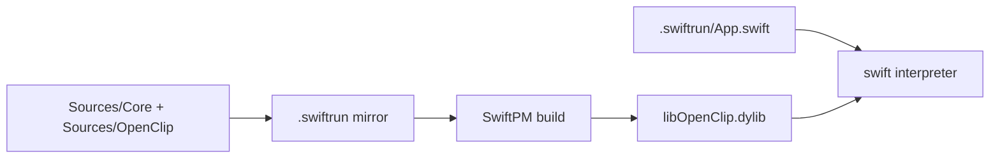

# Running OpenClip Through the Swift Interpreter

`./scripts/dev_swift_run.sh` launches the app without producing a signed `.app`. It builds the app as a
dynamic library and hands a tiny entry file to `swift`, which JIT-executes it inside Apple's signed
`swift-frontend`. The app is never linked into an executable of its own, so a run does not present a new
unknown binary (or to any EDR that gates execution by code signature).

```bash
./scripts/dev_swift_run.sh                  # launch the app
./scripts/dev_swift_run.sh --check          # prepare + build, verify, no launch
./scripts/dev_swift_run.sh --version        # print the version and exit
./scripts/dev_swift_run.sh --dump-logs --category=extensions
./scripts/dev_swift_run.sh --clean          # drop .swiftrun and rebuild from scratch
```

Warm runs take about two seconds; the first run resolves the SPM graph and compiles everything
(~1 minute, needs network). App flags pass straight through; `--check`, `--clean`, `--verbose`, and
`--runner-help` are consumed by the script.

## Why there is no single aggregated `.swift` file

The app cannot be flattened into one source file, and the runner does not pretend otherwise:

- `Core` and `OpenSelection` both declare `AppIdentity`, `CursorClass`, `LogLevel`, `LogMessage`,
  `SelectionGatePolicy`, and `SelectionReadStatus`. `OpenSelectionBridge` disambiguates them with module
  qualifiers such as `Core.CursorClass` and `OpenSelection.SelectionResult`, which stop resolving once
  both modules share a namespace — and the flattened file would be a duplicate-declaration error.
- `SDWebImage` is Objective-C and Sparkle ships as a binary framework, so neither can be textually vendored.

The runner therefore aggregates at the **module** level, which is the smallest unit that preserves the
app's real types and dependencies:



`scripts/swiftrun/prepare.py` mirrors both targets into `.swiftrun/` (gitignored), applies the dev
patches listed below, and writes a generated `Package.swift` whose versions are read from
`OpenClip.xcodeproj/.../Package.resolved`. `swift build` produces one dynamic library that statically
contains Core, OpenSelection, KeyboardShortcuts, SDWebImage, and MarkdownUI, and links Sparkle as a
framework. Both targets are built with `DEBUG` defined, matching the Xcode Debug configuration.

`.swiftrun/App.swift` is the whole program the interpreter sees. It reaches the app through a C symbol
(`openclip_dev_run_main`) exported by the library instead of importing the module, which keeps the
interpreter away from the Clang module maps of the dependencies:

```swift
@_silgen_name("openclip_dev_run_main")
func openclipDevRunMain()

openclipDevRunMain()
```

The symbol is defined by `scripts/swiftrun/DevRunEntry.swift`, which is compiled into the `OpenClip`
target and calls `OpenClipApp.main()` after forcing accessory activation policy (the runtime equivalent
of `LSUIElement`).

## What the run is missing

There is no `Info.plist`, so `Bundle.main` has no identifier and several bundle-only APIs are inert.
Everything below still works; the differences are deliberate and contained.

| Area                                 | Under `swift`                                                                                                 |
| :----------------------------------- | :------------------------------------------------------------------------------------------------------------ |
| Menu bar, popup, actions, extensions | Works. Extensions and trust state are shared with the installed app (`~/.openclip`).                          |
| Global hotkeys                       | Works (Carbon). Quit the installed app first or both compete for the same chords.                             |
| Settings                             | Isolated in `com.openclip.OpenClip.swiftdev` (see below).                                                     |
| Accessibility                        | Works if the terminal or `swift-frontend` is granted Accessibility. The process shows up as `swift-frontend`. |
| Notifications                        | Disabled by a patch; action results that notify report an error instead of aborting the process.              |
| Sparkle updates                      | Inert: `AppUpdateManager.updatesEnabled` requires the `com.openclip.OpenClip` bundle id.                      |
| Login item (`SMAppService`)          | Debug behavior: the toggle only records the preference, so no login item is registered for `swift-frontend`.  |
| Localization                         | English source strings only; `Localizable.xcstrings` is not built.                                            |
| App icon, action sounds              | Generic icon and silence; resources live in `Sources/OpenClip/Resources`, which is excluded.                  |
| `openclip://` deep links             | Not registered (no `CFBundleURLTypes`).                                                                       |
| Apple Events entitlement             | Not applied; Automation prompts go through TCC instead.                                                       |
| OCR / screen capture                 | Prompts for Screen Recording under the `swift-frontend` identity.                                             |

Logging is unchanged: `os.Logger` plus `~/Library/Logs/OpenClip/openclip.log`, shared with the installed
app.

## Settings isolation

`DefaultSettingsStore.shared` normally uses `UserDefaults.standard`, which for an unbundled process is
the `swift-frontend` domain. The runner patches it to a dedicated suite so dev runs do not pollute that
domain and can be reset independently:

```bash
defaults read com.openclip.OpenClip.swiftdev
defaults delete com.openclip.OpenClip.swiftdev   # reset the dev run's settings
```

Point `OPENCLIP_DEVRUN_DEFAULTS` at another suite name to override it. KeyboardShortcuts still stores
its overrides through `UserDefaults.standard`, so custom chords land in the `swift-frontend` domain.

Because the dev domain starts empty, the first launch shows onboarding. Complete it once (it persists), or
skip it:

```bash
defaults write com.openclip.OpenClip.swiftdev hasCompletedOnboarding -bool true
```

`--version` reports `unknown`: there is no `Info.plist`, so `Bundle.main` has no version keys.

## App version

Extension `minOpenClipVersion` floors are compared against the running app's
`CFBundleShortVersionString`, which an interpreter run does not have. `dev_swift_run.sh` therefore
exports `OPENCLIP_DEVRUN_VERSION` from `project.yml`'s `MARKETING_VERSION`, and the `ExtensionManager`
patch below reads it, so a dev run behaves like a build of the current source instead of gating every
extension as "needs OpenClip 0.0.0 or newer". Override it to simulate another release:

```bash
OPENCLIP_DEVRUN_VERSION=1.9.0 ./scripts/dev_swift_run.sh   # exercise a version gate on purpose
```

A floor above the current `MARKETING_VERSION` still gates, which is correct: bump the project version
before authoring against the newer contract.

## Dev patches

`scripts/swiftrun/patches.json` holds exact-string patches applied to the mirrored copy only; the
repository sources are never modified. Each patch must match exactly once, and `prepare.py` fails loudly
if an anchor disappears, which is the signal to revisit the patch:

| File                        | Reason                                                                                                                                                                                      |
| :-------------------------- | :------------------------------------------------------------------------------------------------------------------------------------------------------------------------------------------ |
| `AppDelegate.swift`         | `UNUserNotificationCenter.current()` throws `NSInternalInconsistencyException` when `bundleProxyForCurrentProcess` is nil.                                                                  |
| `AppUpdateManager.swift`    | `UpdateNotificationClient.live` builds that notification center eagerly during `AppUpdateManager.shared` initialization.                                                                    |
| `ActionResultHandler.swift` | Notification-producing actions should surface an error, not abort.                                                                                                                          |
| `SettingsStore.swift`       | Route the shared store to the dev suite above.                                                                                                                                              |
| `ExtensionManager.swift`    | No `Info.plist` means no `CFBundleShortVersionString`, so every `minOpenClipVersion` floor would read `0.0.0` and gate the extension. The dev version comes from `OPENCLIP_DEVRUN_VERSION`. |
| `StatusBarController.swift` | Dev runs have no asset catalog, so the menu bar icon uses the `character.cursor.ibeam` SF Symbol instead of `MenuBarIcon`.                                                                  |

If a patch stops applying, update `patches.json` against the new source; do not relax the matcher. The
same repair playbook is available to agents as the project skill `.devin/skills/openclip-swift-run`
(`/openclip-swift-run`).

## Verifying the build output

The build directory contains libraries and object files, never an executable. `.build/debug` is a
symlink and dylibs carry the executable bit, so test the Mach-O type rather than permissions:

```bash
./scripts/dev_swift_run.sh --check                            # prepare + build, then verify; no launch
file .swiftrun/.build/debug/* | grep 'Mach-O.*executable'      # prints nothing
```

`--check` exits non-zero if an executable appears, so it can gate a change without starting the UI.

The process is Apple's `swift-frontend`; `libOpenClip.dylib` and the other artifacts are loaded, not
executed. SwiftPM also unpacks Sparkle's helper binaries into the scratch directory, but nothing starts
them because updates are disabled.

## Troubleshooting

- **`error: patch anchor no longer exists`** — app source moved; update `scripts/swiftrun/patches.json`.
- **`no such module 'X'`** — a new direct SPM dependency was added to `project.yml`; add it to
  `DIRECT_PACKAGES` in `scripts/swiftrun/prepare.py`.
- **First run hangs on "Fetching …"** — SwiftPM is resolving packages; later runs use the local cache.
- **Build failure** — the last 60 lines of `.swiftrun/build.log` are printed; use `--verbose` for the full log.
- **`actool` version probing fails even after `xcodebuild -runFirstLaunch`** — the runner retries automatically with `swift build --build-system native`, which avoids the failing default `swiftbuild` engine on some Xcode toolchains. The fallback is remembered in `.swiftrun/native-build-system` (keyed to `swift --version`), so later runs go straight to the native engine until the toolchain changes or you pass `--clean`.
- **Hotkey does nothing** — the installed OpenClip is probably running and owns the chord; quit it.
- **Popup opens with no text** — Accessibility is not granted to the terminal/`swift-frontend`, or the
  selection engine declined (see `--dump-logs --category=selection`).
- **Stale mirror or weird incremental state** — `./scripts/dev_swift_run.sh --clean`.
